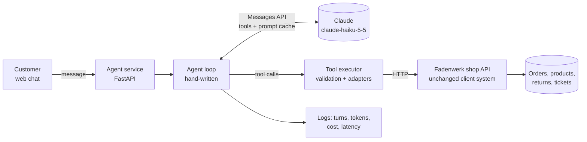

# 03 · Solution Design

> **Simulated engagement: fictional company, synthetic data.**

## Architecture

The agent never touches the shop's database. Everything goes through the shop API, the same way it would at a real client.

## The agent loop

The loop is written by hand on the Anthropic Messages API, without a framework, so every step is visible and testable (`agent/loop.py`):

1. Append the customer message and call the model with the system prompt, the tool list, adaptive thinking, effort `low` and prompt caching.
2. If the model asks for tools, run each one, and return **all** results in one message together with a short language note. Then call the model again.
3. Stop on a normal answer. On a refusal, a cut-off answer, an API error that the SDK's retries could not fix, or more than 8 tool rounds, reply with a fixed German fallback that offers the human team. The history stays valid, so the next message works.

The history is append-only: the model's output goes back exactly as it came, including thinking blocks. That keeps the prompt cache valid and every follow-up request well-formed.

## Tools

| Tool | What it does | Notes |
|---|---|---|
| `lookup_order` | Order status, tracking, items with returnability | Needs order number + postcode or email |
| `start_return` | Creates a return for chosen lines | The shop API enforces the policy; all-or-nothing |
| `search_products` | Product facts | **Adapter:** the shop's search matches the exact query only; if that finds nothing, our side retries per keyword and ranks by matches |
| `get_size_chart` | Raw size chart | |
| `recommend_size` | Per-size differences, recommended and closest size | **Computed on our side.** The first evals showed the model inverting comparisons ("38 is above your measurements"); arithmetic now lives in code |
| `get_policy` | Return and shipping policy | Source of truth for policy answers |
| `handoff_to_human` | Ticket with reason and German summary | One ticket per issue; email collected first |

Every tool has a strict JSON schema. Inputs are validated again in code, so a malformed call becomes an error message to the model, never a crash.

## Guardrails: where each one is enforced

| Guardrail | Enforced in | Why there |
|---|---|---|
| Order data only after verification | **Shop API** (same 404 for unknown and unverified) | The model cannot leak what it never receives |
| No other customers' data | **Shop API** (no names, emails or addresses in responses) + prompt | Defence in depth |
| No out-of-policy returns | **Shop API** (reason code per line) | A prompt can be talked around; an API cannot |
| No promises or exceptions | Prompt | Wording is the model's job; checked by the LLM judge |
| Prompt injection in product text | Prompt (tool results are data) + eval scenarios | Product descriptions are merchant-written and untrusted |
| Reply language | Prompt + a note after every tool result | German tool data pulled English conversations into German |
| Fallback on refusal, API errors or runaway tool loops | Loop code | The customer always gets a usable answer, and the conversation can continue |

## Cost and latency design

- **Model:** `claude-haiku-5-5`, the cheapest current model. The eval suite showed it clears the quality bar, so there is no reason to pay more (see `04-eval-report.md`).
- **Effort `low`:** this is chat with short answers. Deeper reasoning showed no need in the evals.
- **Prompt caching:** the system prompt and tool list are byte-identical on every request, so from the second request on most input tokens are cache reads, at 10 % of the input price.
- **Logging:** every turn records tokens, cost, latency and tool calls into a spend ledger. Eval runs refuse to start once the ledger reaches the $5 engagement cap.

## Trade-offs

- **Hand-written loop vs. a framework.** More code to own, but no hidden behaviour, and every edge case (refusal, cut-off tool call, iteration limit) has a unit test.
- **Asking for an email before a ticket.** One extra question for the customer, but a ticket the team cannot answer is worthless. For legal threats the agent asks for nothing else and does not discuss the matter.
- **German ticket summaries for English customers.** The team works in German, so summaries stay in German by design.
- **No live deployment in this engagement.** The demo is a replay of recorded runs, and a deployment runbook is part of `05-handover.md`.
